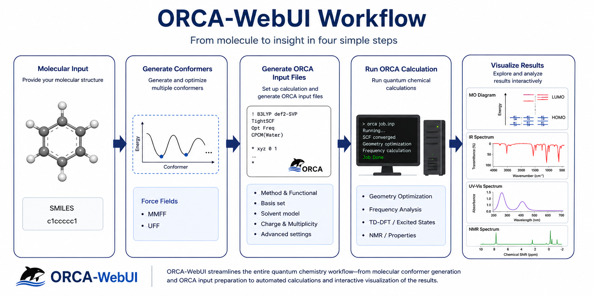
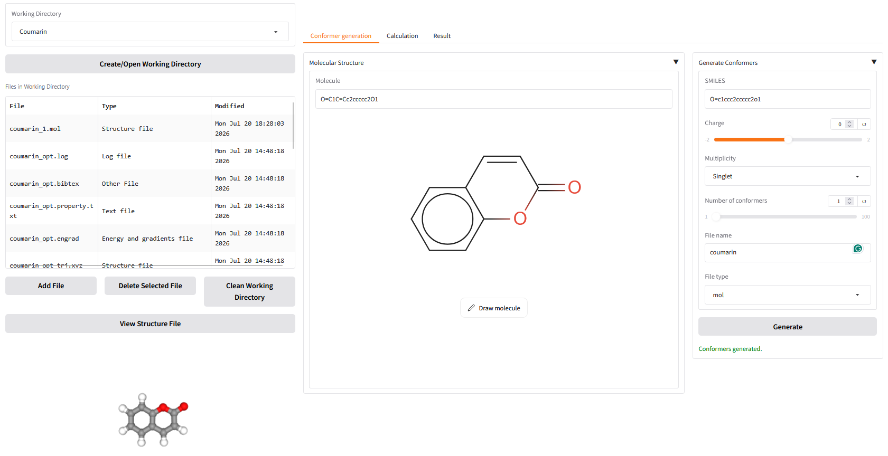
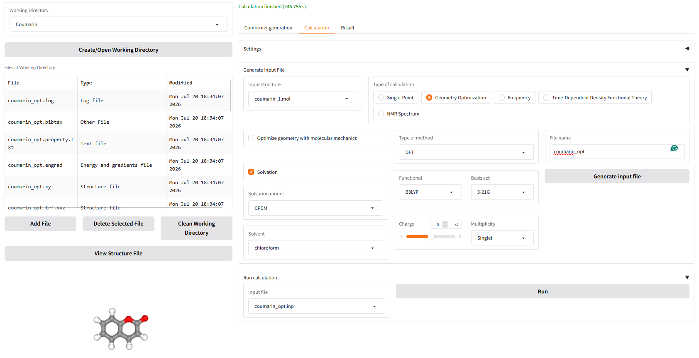
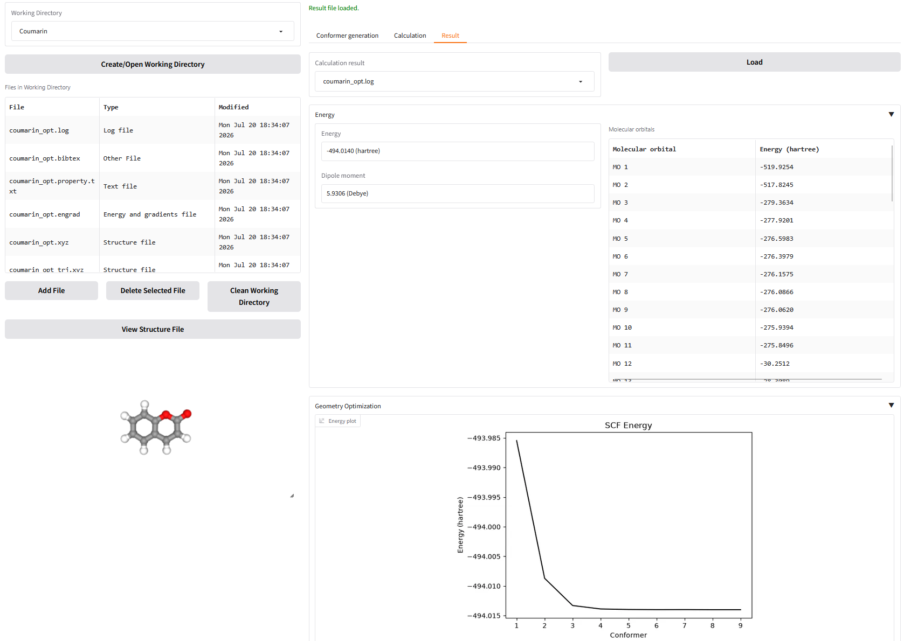
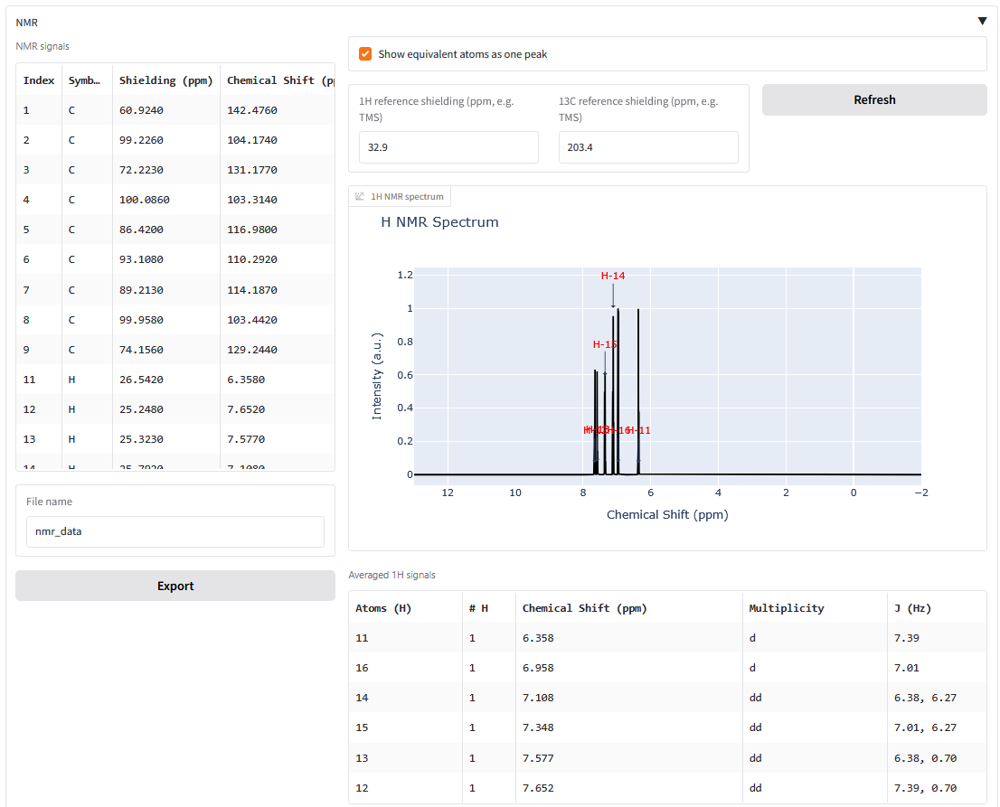
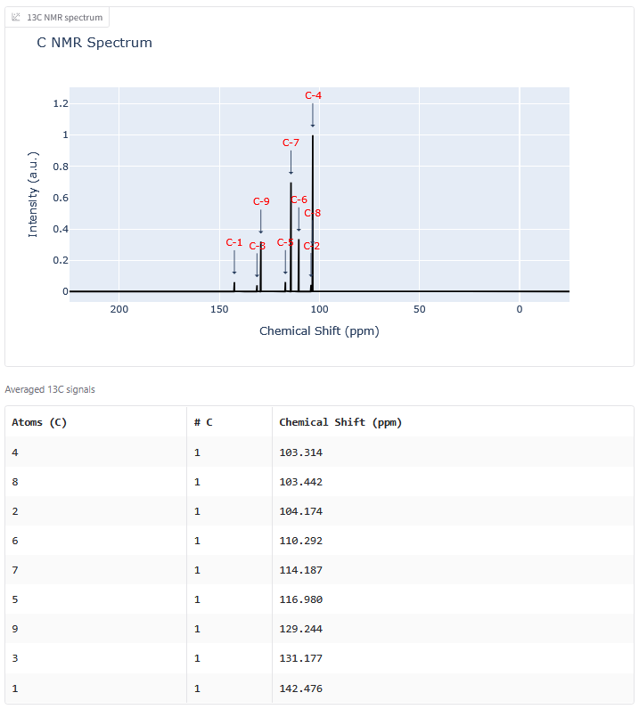

## Introduction
This web UI is for simple computational chemistry calculations with [ORCA](https://www.faccts.de/orca/):

* Single-Point Calculation

* Geometry Optimization

* Frequency Analysis

* Absorption/Emission Spectrum Prediction

* NMR Prediction

<p style="display: flex; justify-content: space-between; gap: 10px;">
  
</p>
<p style="display: flex; justify-content: space-between; gap: 10px;">
  
  
</p>
<p style="display: flex; justify-content: space-between; gap: 10px;">
  
  
</p>

> **Note:** This web UI drives the external [ORCA](https://www.faccts.de/orca/)
> program but does **not** bundle it. Install ORCA separately (free for academic use)
> and make sure the `orca` executable is on your `PATH`; only then can calculations be
> run. Input-file generation and result parsing work without it.

## Installation

The recommended way to install is the [PyPI package](https://pypi.org/project/orca-webui/) (Python 3.10+).

First create and activate a virtual environment so the dependencies stay isolated from your system Python:

***For Linux and macOS***

```
python3 -m venv orca-env
source orca-env/bin/activate
```

***For Windows***

```
python -m venv orca-env
orca-env\Scripts\activate.bat
```

Then install the package from PyPI:

```
pip install orca-webui
```

This pulls in all Python dependencies (Gradio, RDKit, cclib, plotly, nglview, ...).

### Optional: 2D structure editor

The conformer tab can show a 2D drawing editor powered by `gradio_molecule2d`. That
package pins `gradio<5.0`, which conflicts with the `gradio 5.x` this app uses, so it
is **not** installed automatically. To enable the editor, install it without its
dependencies:

```
pip install gradio_molecule2d --no-deps
```

Without it, the app runs fine — you simply enter a SMILES string directly instead of
drawing.

### Newer ORCA versions (6.1+) and cclib

Results are parsed with [cclib](https://cclib.github.io/). The latest **released** cclib
(1.8.1) predates ORCA 6.1 and cannot parse its output — loading such a result file fails
with an error like *"cclib could not parse this file ... list index out of range."* The
fix is already in cclib's development version, so until the next cclib release, install it
from git:

```
pip install --upgrade "cclib @ git+https://github.com/cclib/cclib.git"
```

If your calculations come from ORCA 6.0 or earlier, the released cclib pulled in by
`pip install orca-webui` is sufficient.

## Start web UI

Run the console command from the directory where you want your `data/` and `static/`
folders to be created:

```
orca-webui
```

It starts a local server on the first free port at/after 7860 (open the printed URL in
your browser).

## Development (from source)

You never need to publish to PyPI to work on the app — that step is only for *other*
people to install it.

```
git clone https://github.com/phatdatnguyen/orca-webui
cd orca-webui

# create and activate a virtual environment
python -m venv orca-env
source orca-env/bin/activate          # Windows: orca-env\Scripts\activate.bat

# install in editable mode with the dev extras (pytest, build, twine)
pip install -e ".[dev]"
pip install gradio_molecule2d --no-deps   # optional 2D editor, see above

# run the app and the tests
orca-webui
pytest
```

The `-e` (editable) flag is the important part: pip records a path hook pointing at
`src/`, so your edits are picked up on the next restart and you never reinstall. A plain
`pip install .` *copies* the package into `site-packages`, which is why changes appear to
be ignored until you reinstall. To check which one you have:

```
pip show orca-webui | grep -i location   # editable installs report the repo's src/ path
```

If it points into `site-packages`, swap it:

```
pip uninstall -y orca-webui
pip install -e .
```

### Running without installing at all

Because `orca_webui` is a regular package with relative imports, you can run it straight
from the source tree:

```
PYTHONPATH=src python -m orca_webui.app
```

Use `python -m orca_webui.app`, not `python src/orca_webui/app.py` — the latter fails on
the package-relative imports. Run it from the repository root, since `build_app()` creates
`data/` and `static/` relative to the current working directory.

### Auto-reload on file save

`build_app()` returns the FastAPI app, so it can be used directly as a uvicorn factory:

```
PYTHONPATH=src python -m uvicorn orca_webui.app:build_app --factory --reload --reload-dir src --port 7860
```

The server restarts whenever anything under `src/` changes. Note that `--reload` bypasses
`main()`, so the automatic "first free port at/after 7860" selection does not apply — pick
the port yourself.

### Copying the project to another directory

Virtual environments are **not** relocatable: `orca-env/pyvenv.cfg` and the activate
scripts contain the absolute path they were created at. After copying or moving the
project, delete the old environment and recreate it:

```
rm -rf orca-env
python -m venv orca-env
source orca-env/bin/activate
pip install -e ".[dev]"
```